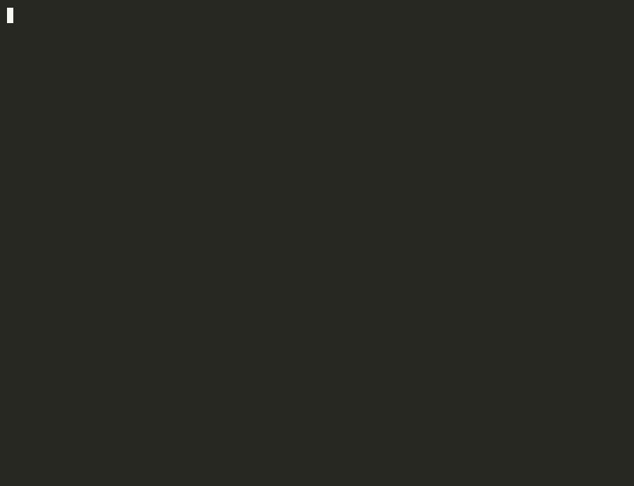

# xlib

Tulis modul sekali (di Rust, C++, atau Go), lalu pakai dari Python, Kotlin, Swift, Go, dan (nanti) JavaScript. Begitu saja idenya.



## Kenapa bikin ini

Saya sering ketemu logika yang sama ditulis ulang di beberapa tempat. Contohnya validasi atau perhitungan yang ada di backend Python, lalu harus ditulis lagi di aplikasi Android dan iOS. Setiap ada perubahan, harus ingat update di tiga tempat, dan biasanya ada satu yang ketinggalan.

Sebenarnya alatnya sudah ada. [UniFFI](https://github.com/mozilla/uniffi-rs) dari Mozilla bisa membuat binding dari Rust ke banyak bahasa. Tapi setiap mau build, saya harus ingat urutan perintahnya, nama library-nya, flag-nya, dan cara merapikan hasilnya per bahasa. `xlib` pada dasarnya membungkus semua itu jadi satu perintah dengan menu yang bisa dicentang.

## Cara pakai

Install CLI-nya dulu:

```bash
git clone https://github.com/fadhelmurphy/xlib
cd xlib/cli
cargo install --path .
```

Buat modul baru:

```bash
xlib init mathlib
cd mathlib
```

Nanti akan ditanya modulnya mau ditulis pakai bahasa apa. Bisa juga langsung lewat flag:

```bash
xlib init mathlib --lang rust
xlib init mathlib --lang cpp
xlib init mathlib --lang go
```

Setiap template sudah berisi contoh fungsi yang siap di-build, termasuk satu fungsi yang bisa error. Tinggal ubah sesuai kebutuhan.

Lalu build:

```bash
xlib build
```

Akan muncul menu untuk memilih bahasa target. Pilihan terakhir diingat, jadi build berikutnya tinggal tekan enter.

Untuk CI atau kalau malas pakai menu:

```bash
xlib build --target python,kotlin
xlib build --all
xlib build --force    # abaikan cache
```

Hasilnya masuk ke `dist/<bahasa>/`. Di tiap folder ada `CARA_PAKAI.txt` berisi langkah singkat untuk bahasa tersebut.

Kalau ada target yang belum bisa di-build, jalankan:

```bash
xlib doctor
```

Perintah ini mengecek toolchain mana yang sudah siap dan mana yang belum.

## Contoh pemakaian

Folder `examples/mathlib/consumers/` berisi contoh memanggil modul yang sama dari beberapa bahasa.

Python:

```python
import mathlib

print(mathlib.add(2, 3))
print(mathlib.describe([4.0, 8.0, 15.0, 16.0]))
```

Kotlin:

```kotlin
import uniffi.mathlib.*

fun main() {
    println(add(2, 3))
    println(describe(listOf(4.0, 8.0, 15.0, 16.0)))
}
```

Error dari Rust otomatis jadi exception di Python dan Kotlin, jadi tidak perlu cek kode error manual.

## Bahasa sumber

Modul bisa ditulis di tiga bahasa. Dari sisi pemakai tidak ada bedanya, karena semuanya keluar sebagai package Python, Kotlin, Swift, dan seterusnya.

**Rust** adalah yang paling lengkap. Selain fungsi, kamu bisa mengekspor struct, object yang punya state, dan enum error. Tulis di `src/lib.rs`, lalu tandai dengan `#[uniffi::export]`.

**C++**: tulis fungsi biasa di `include/*.hpp` dan implementasinya di `src/*.cpp`. Tidak perlu anotasi apa-apa. Fungsi yang tidak ditandai `noexcept` dianggap bisa melempar exception, dan exception itu muncul sebagai error di bahasa pemakai.

```cpp
namespace mathlib {
int64_t add(int64_t a, int64_t b) noexcept;
double mean(const std::vector<double>& values);   // boleh throw
}
```

**Go**: tulis package biasa. Semua fungsi yang diawali huruf kapital ikut diekspor. Kalau fungsi mengembalikan `error`, di Python atau Kotlin error itu jadi exception. Panic juga ditangkap, jadi tidak akan membuat aplikasi pemakainya crash.

```go
func Add(a, b int64) int64 { ... }
func Mean(values []float64) (float64, error) { ... }
```

Untuk C++ dan Go, tipe yang didukung untuk sekarang masih dasar: bool, integer, float/double, string, serta list of double atau int64. Fungsi yang memakai tipe lain akan dilewati, dan `xlib build` menyebutkan fungsi mana saja yang dilewati beserta alasannya. Struct dan class belum bisa.

Bagaimana dengan Python dan JavaScript sebagai sumber? Belum bisa. Dua bahasa ini butuh runtime sendiri, jadi interpreter-nya harus ikut dibawa ke mana-mana. Jalan yang masuk akal adalah lewat Wasm, dan itu masih dalam rencana.

### Cara kerjanya

Untuk C++ dan Go, xlib membaca header atau file `.go`, lalu membuat dua hal secara otomatis di folder `.xlib/`:

1. Wrapper C ABI di bahasa itu sendiri (`extern "C"` untuk C++, `//export` lewat cgo untuk Go). Wrapper ini juga mengurus konversi string, list, dan exception/error.
2. Crate Rust tipis yang memanggil wrapper tadi dan mengekspornya lewat UniFFI.

Setelah itu prosesnya sama persis dengan modul Rust. Karena itu, setiap target baru yang ditambahkan otomatis berlaku untuk ketiga bahasa sumber.

## Status

Masih prototipe. Yang sudah saya coba sendiri:

- **Python**: jalan, bisa di-`pip install`. Sudah dites dengan modul Rust, C++, dan Go.
- **Kotlin**: jalan di JVM (butuh JNA). Sudah dites dengan modul Rust, C++, dan Go.
- **Rust**: jalan, karena memang crate biasa
- **Swift**: binding, header, dan modulemap sudah dibuat, tapi belum saya tes di Xcode
- **Go**: butuh [`uniffi-bindgen-go`](https://github.com/NordSecurity/uniffi-bindgen-go), belum saya tes end-to-end
- **JavaScript**: belum ada

## Hal yang perlu diketahui

Dua hal ini sempat bikin saya bingung, jadi saya catat di sini:

- Versi UniFFI dikunci ke `0.31`, karena `uniffi-bindgen-go` belum mengikuti versi terbaru. Kalau dinaikkan, binding Go kemungkinan besar rusak.
- Jangan pakai `strip = true` di profile release. Metadata UniFFI ikut terhapus, dan hasilnya error `No UniFFI metadata found` yang tidak jelas penyebabnya.

## Rencana

- [ ] Target JavaScript (napi-rs untuk Node, wasm untuk browser)
- [ ] Packaging Swift jadi XCFramework / Swift Package
- [ ] Packaging Kotlin jadi AAR untuk Android
- [ ] Perintah `xlib publish` ke PyPI, Maven, npm, dan seterusnya
- [ ] Struct dan class untuk modul C++ dan Go
- [ ] Python dan JavaScript sebagai bahasa sumber (lewat Wasm)
- [ ] Backend Wasm Component Model sebagai alternatif UniFFI

Desainnya memang disiapkan supaya backend bisa diganti. Kalau suatu saat Wasm Component Model sudah cukup matang, kode modul tidak perlu diubah, cukup ganti `backend` di `xlib.toml`.

## Struktur repo

```
cli/                  kode CLI xlib
cli/src/sources/      parser + generator untuk modul C++ dan Go
cli/templates/        template yang dipakai `xlib init`
examples/mathlib/     contoh modul Rust + consumer di beberapa bahasa
examples/cppmath/     contoh modul C++
examples/gomath/      contoh modul Go
```

Menambah bahasa target baru cukup dengan menambah satu entri di `cli/src/targets.rs`.

## Lisensi

MIT
